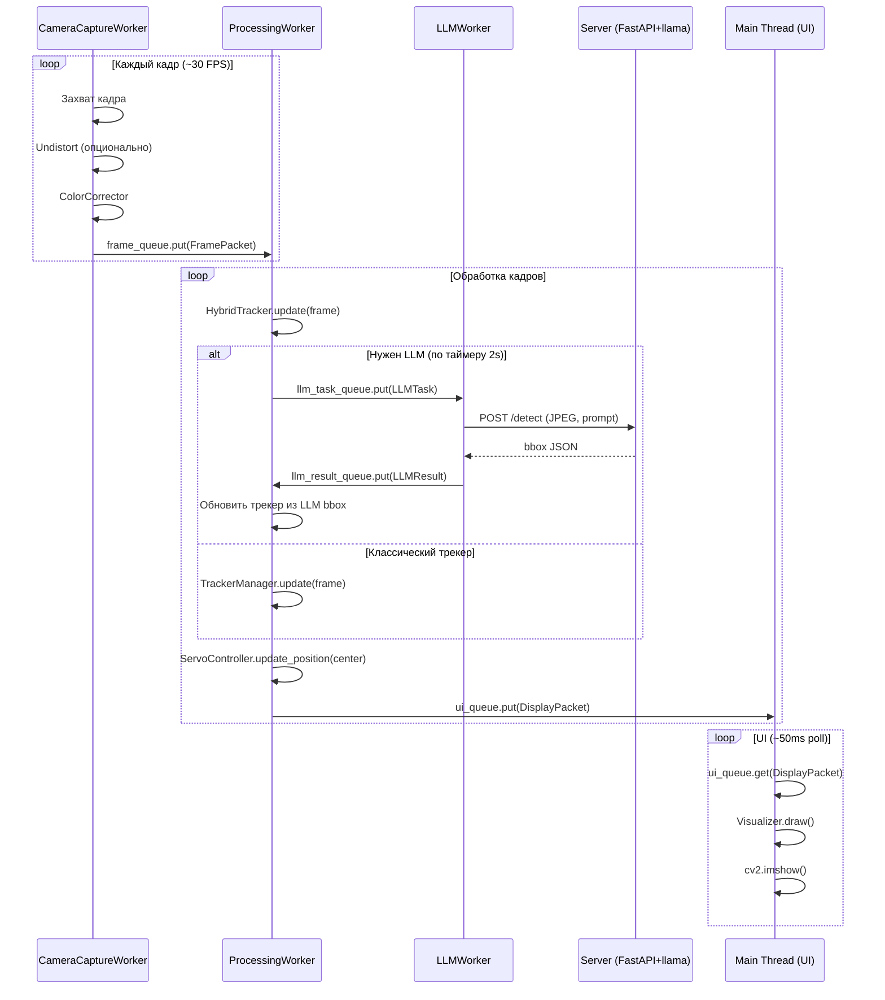
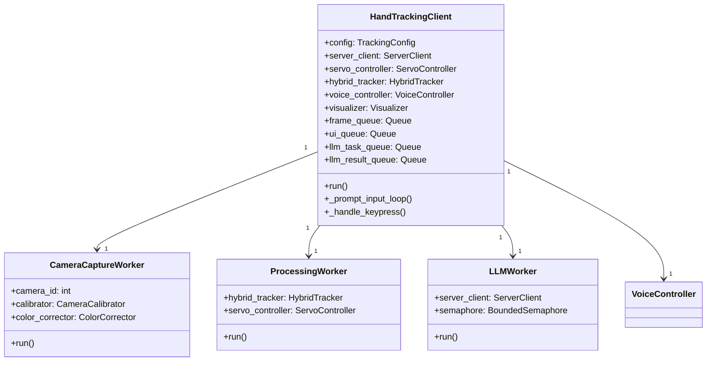
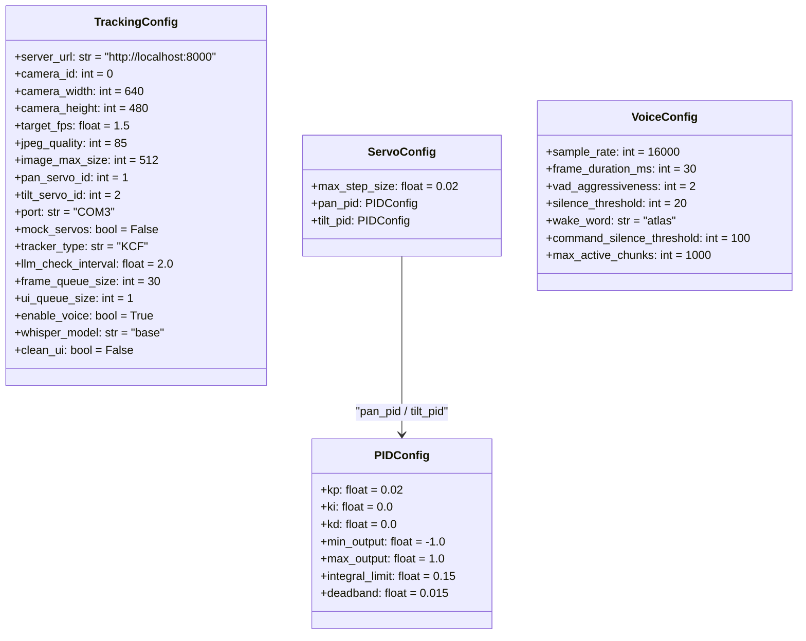
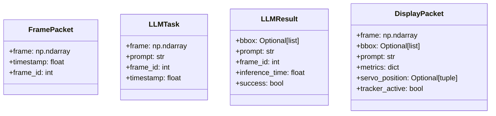
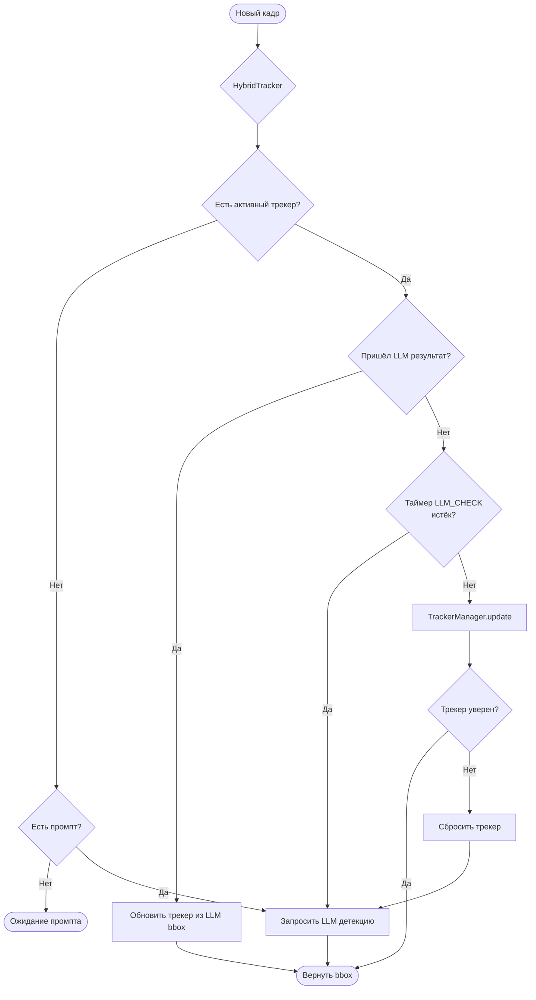
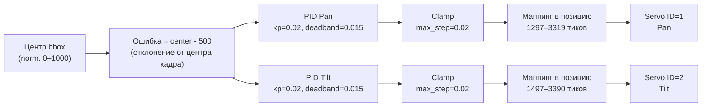
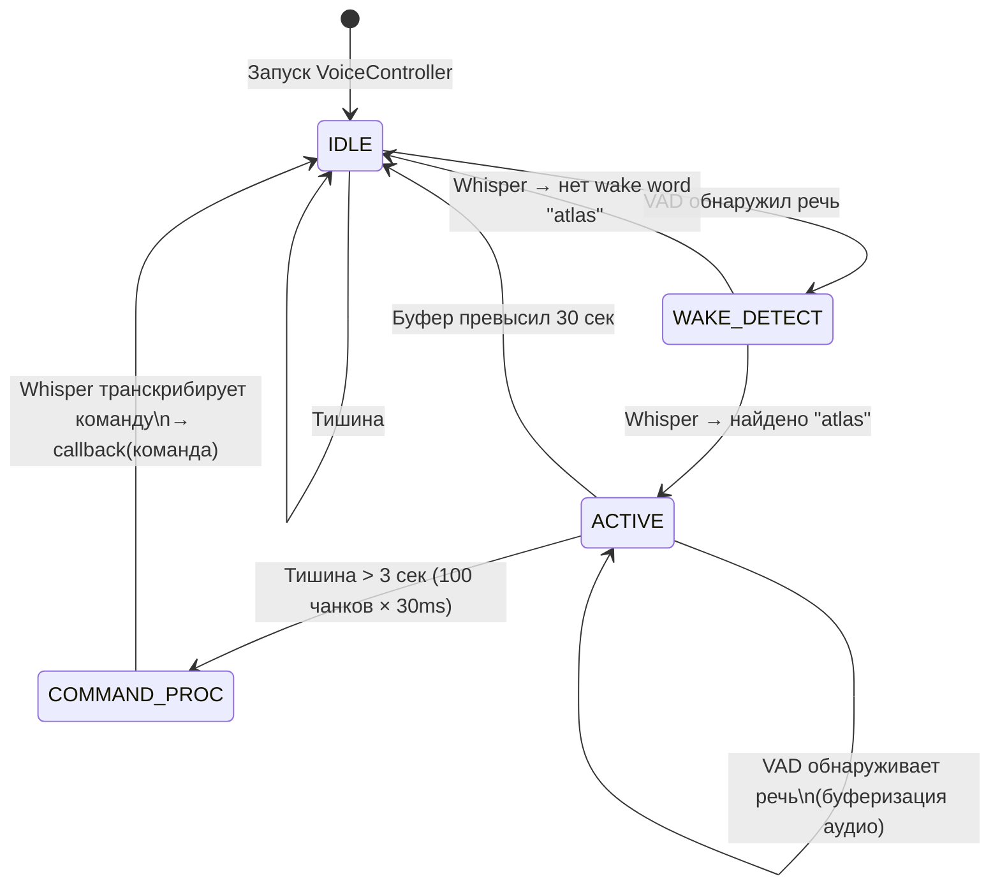
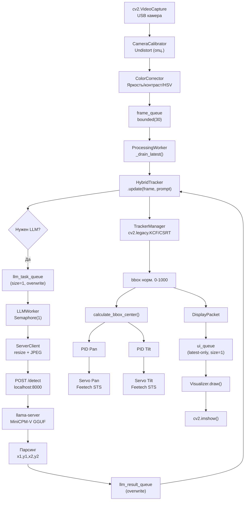
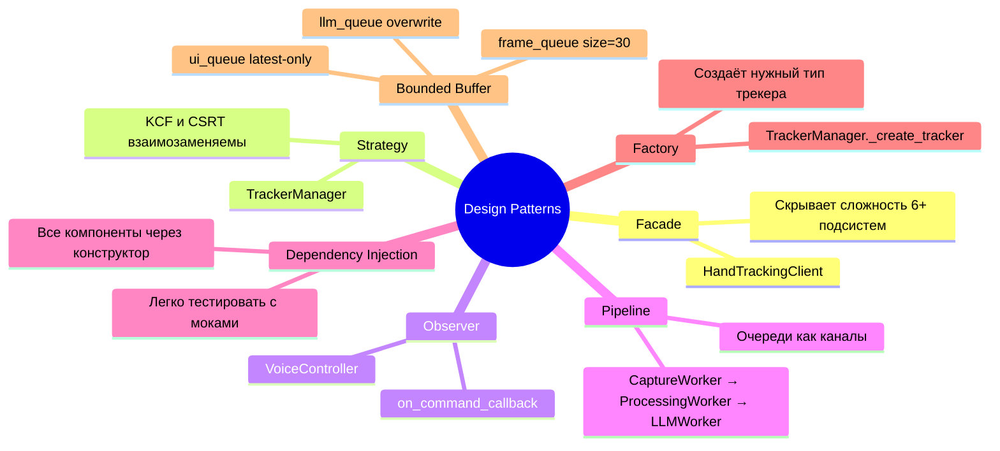

# MiniCPM Hand Detect & Track — Полное описание проекта

> Интегрированная система отслеживания объектов с использованием мультимодальной языковой модели MiniCPM-V, классических трекеров OpenCV, голосового управления (Whisper) и аппаратных сервоприводов Feetech.

---

## Оглавление

1. [Общее описание](#1-общее-описание)
2. [Структура проекта](#2-структура-проекта)
3. [Архитектура системы](#3-архитектура-системы)
4. [Компоненты системы](#4-компоненты-системы)
   - 4.1 [Сервер детекции (hand_tracking_server.py)](#41-сервер-детекции)
   - 4.2 [Модульный клиент (hand_tracking_client.py)](#42-модульный-клиент)
   - 4.3 [Конфигурация (config/)](#43-конфигурация)
   - 4.4 [Пайплайн потоков (pipeline/)](#44-пайплайн-потоков)
   - 4.5 [Трекинг (tracking/)](#45-трекинг)
   - 4.6 [Управление сервоприводами (servo/)](#46-управление-сервоприводами)
   - 4.7 [Голосовое управление (voice/)](#47-голосовое-управление)
   - 4.8 [Обработка изображений (image/)](#48-обработка-изображений)
   - 4.9 [Сетевой клиент (network/)](#49-сетевой-клиент)
   - 4.10 [Визуализация (ui/)](#410-визуализация)
   - 4.11 [Утилиты (utils/)](#411-утилиты)
5. [Поток данных](#5-поток-данных)
6. [Конфигурационные файлы](#6-конфигурационные-файлы)
7. [Запуск системы](#7-запуск-системы)
8. [Легаси-клиент](#8-легаси-клиент)
9. [Паттерны проектирования](#9-паттерны-проектирования)
10. [Производительность и оптимизации](#10-производительность-и-оптимизации)
11. [Настройка PID](#11-настройка-pid)

---

## 1. Общее описание

Система решает задачу **автоматического отслеживания произвольного объекта** в реальном времени с физическим поворотом камеры на сервоприводах. Пользователь голосом или текстом задаёт, что нужно отслеживать («hand», «phone», «cup»), после чего система:

1. Определяет координаты объекта в кадре с помощью **VLM (MiniCPM-V GGUF)** через llama.cpp.
2. Поддерживает трекинг между LLM-вызовами с помощью **классических трекеров OpenCV** (KCF / CSRT).
3. Рассчитывает управляющее воздействие через **PID-регулятор** и двигает сервоприводы **pan/tilt**.
4. Отображает видеопоток с наложенными bounding box и метриками в реальном времени.

---

## 2. Структура проекта

```
Minicpm_hand_detect_and_track/
├── main.py                         # CLI точка входа
├── hand_tracking_client.py         # Главный оркестратор (модульный)
├── hand_tracking_client_old.py     # Устаревший монолитный клиент
├── hand_tracking_server.py         # FastAPI сервер + llama-server процесс
├── feetech_servo.py                # Низкоуровневый драйвер сервоприводов
├── pid_controller.py               # PID-регулятор
├── calibration.py                  # Менеджер калибровки сервоприводов
├── color_correction.py             # Интерактивный инструмент цветокоррекции
├── list_cameras.py                 # Утилита для списка доступных камер
├── test_imports.py                 # Тест импортов
├── calibration.json                # Данные калибровки сервоприводов
├── camera_calibration.json         # Данные калибровки камеры (fisheye)
├── requirements.txt                # Python зависимости
├── README.md                       # Основная документация
├── ARCHITECTURE.md                 # Документация архитектуры
│
├── config/                         # Конфигурационные датаклассы
│   ├── settings.py                 # TrackingConfig, PIDConfig, ServoConfig, VoiceConfig
│   └── color_params.py             # ColorCorrectionParams
│
├── pipeline/                       # Воркеры многопоточного пайплайна
│   ├── messages.py                 # FramePacket, LLMTask, LLMResult, DisplayPacket
│   ├── capture_worker.py           # Захват кадров с камеры
│   ├── processing_worker.py        # Трекинг + управление сервоприводами
│   └── llm_worker.py               # Асинхронные запросы к VLM
│
├── tracking/                       # Алгоритмы трекинга
│   ├── tracker_manager.py          # Обёртка над OpenCV трекерами
│   └── hybrid_tracker.py           # Гибридный LLM + классический трекер
│
├── servo/
│   └── servo_controller.py         # PID-управление сервоприводами
│
├── voice/
│   └── voice_controller.py         # VAD + Whisper транскрипция
│
├── image/
│   ├── camera_calibration.py       # Коррекция дисторсии объектива
│   └── color_correction.py         # ColorCorrector (яркость, контраст, HSV)
│
├── network/
│   └── server_client.py            # HTTP-клиент к серверу детекции
│
├── ui/
│   └── visualization.py            # Рисование bbox, оверлеев, метрик
│
└── utils/
    ├── coordinates.py              # Конвертация координат (нормализованные ↔ пиксели)
    └── metrics.py                  # PerformanceMetrics (скользящие средние)
```

---

## 3. Архитектура системы

### Высокоуровневая архитектура

```mermaid
graph TB
    subgraph PC["Компьютер / Ноутбук"]
        subgraph SERVER["Процесс: hand_tracking_server.py"]
            FASTAPI["FastAPI :8000\n/detect  /health  /stats"]
            LLAMA["llama-server subprocess\n:8085 (MiniCPM-V GGUF)"]
            FASTAPI <-->|HTTP| LLAMA
        end

        subgraph CLIENT["Процесс: main.py → HandTrackingClient"]
            MAIN["Главный поток\nCV2 imshow"]
            CAP["CameraCaptureWorker\n(Thread)"]
            PROC["ProcessingWorker\n(Thread)"]
            LLM["LLMWorker\n(Thread)"]
            VOICE["VoiceController\n(Thread)"]
            CONSOLE["ConsoleInput\n(Thread)"]

            CAP -->|frame_queue| PROC
            PROC -->|llm_task_queue| LLM
            LLM -->|llm_result_queue| PROC
            PROC -->|ui_queue| MAIN
            VOICE -->|callback| MAIN
            CONSOLE -->|Lock| MAIN
        end

        CLIENT -->|POST /detect\n(JPEG + prompt)| FASTAPI
    end

    CAM["USB Камера"] --> CAP
    MIC["Микрофон"] --> VOICE
    MAIN --> DISPLAY["cv2.imshow"]
    PROC -->|ServoController| SERVO["Сервоприводы\nPan + Tilt\n(Feetech STS)"]
```

### Многопоточная модель



---

## 4. Компоненты системы

### 4.1 Сервер детекции

**Файл:** `hand_tracking_server.py`

FastAPI-приложение, которое при старте запускает **дочерний процесс `llama-server`** с мультимодальной моделью MiniCPM-V в формате GGUF. Это позволяет держать модель постоянно загруженной в память и отвечать на запросы детекции без повторной инициализации.

#### Ключевые компоненты сервера

| Класс / функция | Роль |
|---|---|
| `LlamaServerProcess` | Запускает и мониторит дочерний процесс `llama-server` |
| `TrackingServerGGUF` | Клиент к `llama-server`, формирует vision-промпт, парсит ответ |
| `POST /detect` | Принимает JPEG-изображение + текстовый промпт, возвращает bbox |
| `GET /health` | Статус готовности сервера |
| `GET /stats` | Статистика inference (количество запросов, время) |

#### Конфигурация через переменные среды

```bash
LLAMA_CTX_SIZE=4096        # Размер контекста (токенов)
LLAMA_THREADS=auto         # Число CPU потоков
LLAMA_N_PREDICT=1024       # Макс. токенов на ответ
LLAMA_TEMPERATURE=0.7      # Температура сэмплинга
LLAMA_SERVER_LOG=1         # Включить логи llama-server
LLAMA_SERVER_STARTUP_TIMEOUT=180  # Таймаут старта (сек)
```

#### Формат ответа модели

Модель возвращает bounding box в формате `<box>x1,y1,x2,y2</box>`, где координаты **нормализованы в диапазоне 0–1000**. Сервер парсит этот формат regex-ом и возвращает JSON:

```json
{
  "bbox": [245, 310, 580, 720],
  "prompt": "hand",
  "inference_time": 2.34
}
```

---

### 4.2 Модульный клиент

**Файл:** `hand_tracking_client.py`

Главный оркестратор системы. Создаёт все компоненты, запускает потоки, управляет жизненным циклом.



#### Управляющие команды (клавиши видеоокна)

| Клавиша | Действие |
|---|---|
| `q` | Выход из программы |
| `c` | Сбросить текущий объект трекинга |
| `s` | Показать статистику сервера |

---

### 4.3 Конфигурация

**Файл:** `config/settings.py`

Вся конфигурация вынесена в **Python dataclasses**, что обеспечивает типизацию и значения по умолчанию.



---

### 4.4 Пайплайн потоков

**Директория:** `pipeline/`

Система работает на трёх параллельных потоках, общающихся через очереди.

#### Сообщения между потоками (`pipeline/messages.py`)



#### CameraCaptureWorker (`pipeline/capture_worker.py`)

- Читает кадры с камеры через `cv2.VideoCapture`
- Опционально применяет **undistort** через `CameraCalibrator` (если передан файл калибровки)
- Применяет **ColorCorrector** (яркость, контраст, HSV-коррекция)
- Кладёт `FramePacket` в `frame_queue` (bounded, размер 30 — обратное давление)

#### ProcessingWorker (`pipeline/processing_worker.py`)

- Вытаскивает последний кадр из `frame_queue` (дренаж — берёт только самый свежий)
- Запускает `HybridTracker.update(frame, prompt)`
- При необходимости отправляет `LLMTask` в `llm_task_queue`
- Применяет `LLMResult` из `llm_result_queue` для обновления трекера
- Вызывает `ServoController.update_position(center)` для физического движения
- Публикует `DisplayPacket` в `ui_queue` (latest-only, размер 1)

#### LLMWorker (`pipeline/llm_worker.py`)

- Использует `BoundedSemaphore(1)` — **одновременно не более одного запроса к серверу**
- Вызывает `ServerClient.detect(frame, prompt)`
- Кладёт `LLMResult` в `llm_result_queue` (overwrite-семантика)

---

### 4.5 Трекинг

**Директория:** `tracking/`



#### TrackerManager (`tracking/tracker_manager.py`)

Обёртка над `cv2.legacy` трекерами. Поддерживает:

| Тип | Характеристики |
|---|---|
| **KCF** | Быстрый, сбалансированный. Рекомендуется по умолчанию |
| **CSRT** | Более точный, но медленнее. Лучше для сложных случаев |

Координаты bbox хранятся в **нормализованном формате 0–1000**, конвертация в пиксели происходит через `utils/coordinates.py`.

#### HybridTracker (`tracking/hybrid_tracker.py`)

Реализует логику переключения между LLM и классическим трекером:
- **Первичная детекция** — всегда через LLM
- **Поддерживающий трекинг** — классический трекер между LLM-вызовами
- **Периодическая верификация** — LLM перепроверяет каждые `llm_check_interval` секунд (по умолчанию 2.0 с)
- **Восстановление после потери** — при низком confidence классического трекера запрашивает LLM повторно

---

### 4.6 Управление сервоприводами

**Файлы:** `servo/servo_controller.py`, `feetech_servo.py`, `pid_controller.py`, `calibration.py`



#### FeetechServo (`feetech_servo.py`)

Низкоуровневый драйвер для сервоприводов серии **Feetech STS** через `scservo_sdk`. Ключевые параметры:
- Baudrate: **1 000 000**
- Shared `PortHandler` для обоих сервоприводов
- Нормализованный маппинг позиций (0.0–1.0 → тики)

#### CalibrationManager (`calibration.py`)

Загружает пределы движения из `calibration.json`:

```json
{
  "pan":  { "servo_id": 1, "min_position": 1297, "max_position": 3319, "center_position": 2169 },
  "tilt": { "servo_id": 2, "min_position": 1497, "max_position": 3390, "center_position": 2478 }
}
```

---

### 4.7 Голосовое управление

**Файл:** `voice/voice_controller.py`



#### Принцип работы:

1. `sounddevice` захватывает аудио потоком (16 kHz)
2. `webrtcvad` детектирует активность речи (aggressiveness=2)
3. В состоянии **IDLE** — ждёт wake word **"atlas"**
4. В состоянии **ACTIVE** — буферизует речь до паузы 3 секунды
5. `faster-whisper` транскрибирует накопленный буфер
6. Результат передаётся в `HandTrackingClient` через callback

#### Голосовые команды:

| Команда | Действие |
|---|---|
| `"hand"` | Начать трекинг руки |
| `"phone"` | Начать трекинг телефона |
| `"cup"`, `"bottle"`, etc. | Трекинг любого объекта |
| `"clear"` / `"stop"` | Остановить трекинг |
| `"quit"` / `"exit"` | Выйти из программы |

---

### 4.8 Обработка изображений

**Директория:** `image/`

#### CameraCalibrator (`image/camera_calibration.py`)

Применяет коррекцию дисторсии объектива (fisheye / standard). Загружает параметры из `camera_calibration.json`:

```json
{
  "image_size": [1920, 1080],
  "camera_matrix": [[1536.0, 0.0, 960.0], [0.0, 1536.0, 540.0], [0.0, 0.0, 1.0]],
  "dist_coeffs": [0.0, 0.0, 0.0, 0.0],
  "model": "fisheye"
}
```

#### ColorCorrector (`image/color_correction.py`)

Применяет настраиваемую коррекцию цвета к каждому кадру:
- Яркость / контраст (alpha, beta)
- Гамма-коррекция
- Насыщенность / оттенок / значение (HSV)
- Конфигурируется через `ColorCorrectionParams`

#### Интерактивный инструмент (`color_correction.py` в корне)

Standalone-приложение с русскоязычным UI на основе OpenCV trackbars — позволяет визуально настроить параметры коррекции и сохранить в `config/color_params.py`.

---

### 4.9 Сетевой клиент

**Файл:** `network/server_client.py`

| Метод | Описание |
|---|---|
| `detect(frame, prompt)` | Отправляет JPEG-кадр и промпт, возвращает `LLMResult` с bbox |
| `health_check()` | Проверяет доступность сервера |
| `get_stats()` | Получает статистику сервера |

Перед отправкой кадр:
1. Масштабируется до `image_max_size` (по умолчанию 512 пикселей по длинной стороне)
2. Сжимается в JPEG с качеством `jpeg_quality` (по умолчанию 85%)
3. Отправляется как `multipart/form-data`

---

### 4.10 Визуализация

**Файл:** `ui/visualization.py`

`Visualizer` рисует поверх кадра:

- **Bounding box** объекта (цветной прямоугольник)
- **Центр** объекта (перекрестие)
- **Метрики производительности**: FPS захвата, FPS обработки, время LLM inference
- **Статус трекера**: активен / инициализируется / потерян
- **Текущий промпт**
- **Позиции сервоприводов** (нормализованные 0–1)
- **Режим clean_ui** — только bbox, без текстовых оверлеев

---

### 4.11 Утилиты

**Директория:** `utils/`

#### coordinates.py

Работает с двумя системами координат:
- **Нормализованные** (0–1000): формат сервера и трекеров
- **Пиксельные** (0–width/height): формат OpenCV

| Функция | Описание |
|---|---|
| `calculate_bbox_center(bbox)` | Центр bbox в нормализованных координатах |
| `normalize_bbox_to_pixels(bbox, w, h)` | Нормализованные → пиксели |
| `pixels_to_normalized_bbox(bbox, w, h)` | Пиксели → нормализованные |

#### metrics.py

`PerformanceMetrics` хранит скользящие средние через `deque`:
- Время захвата кадра
- Время обработки (трекинг + управление)
- Время LLM inference
- FPS

---

## 5. Поток данных

### Полный жизненный цикл одного кадра



---

## 6. Конфигурационные файлы

### calibration.json — Калибровка сервоприводов

```json
{
  "pan":  { "servo_id": 1, "min_position": 1297, "max_position": 3319, "center_position": 2169 },
  "tilt": { "servo_id": 2, "min_position": 1497, "max_position": 3390, "center_position": 2478 }
}
```

Диапазон движения Pan: **2022 тика**, Tilt: **1893 тика**.

### camera_calibration.json — Калибровка камеры

```json
{
  "image_size": [1920, 1080],
  "camera_matrix": [[1536.0, 0.0, 960.0], [0.0, 1536.0, 540.0], [0.0, 0.0, 1.0]],
  "dist_coeffs": [0.0, 0.0, 0.0, 0.0],
  "rms_error": 1000000000.0,
  "model": "fisheye"
}
```

> Текущие значения `dist_coeffs = [0, 0, 0, 0]` и `rms_error = 1e9` говорят о том, что реальная калибровка ещё не проводилась — это placeholder. Для fisheye-объектива необходимо провести калибровку через `calibration.py`.

---

## 7. Запуск системы

### Предварительные требования

```bash
pip install -r requirements.txt
# feetech-servo-sdk устанавливается как scservo-sdk:
pip install scservo-sdk
```

### Шаг 1: Запуск сервера

```bash
cd Minicpm_hand_detect_and_track
python hand_tracking_server.py --host localhost --port 8000
# Ждём: [STARTUP] llama-server is ready at http://127.0.0.1:8085
```

### Шаг 2: Определить камеру

```bash
python list_cameras.py
```

### Шаг 3: Запуск клиента

```bash
# С сервоприводами (macOS):
python main.py --port /dev/tty.usbserial-0001 --camera 1

# Без сервоприводов (тестирование):
python main.py --mock-servos --camera 0

# Без голосового управления:
python main.py --no-voice --mock-servos --camera 0
```

### Пресеты производительности

| Режим | Команда |
|---|---|
| **Быстрый** | `python main.py --fps 1.0 --image-size 384 --whisper-model tiny` |
| **Сбалансированный** | `python main.py --fps 1.5 --image-size 512 --whisper-model base` |
| **Качественный** | `python main.py --fps 1.5 --image-size 768 --whisper-model small` |

---

## 8. Легаси-клиент

**Файл:** `hand_tracking_client_old.py` (~1393 строки)

Монолитный однопоточный клиент — предыдущая версия системы до рефакторинга. Все функции (захват камеры, детекция, трекинг, управление сервоприводами, голосовое управление) реализованы в одном классе и одном цикле `run()`.

#### Сравнение с модульным клиентом

| Аспект | Легаси (`_old.py`) | Модульный (`hand_tracking_client.py`) |
|---|---|---|
| Архитектура | Монолит, 1 поток | Пайплайн, 4 потока |
| Захват кадров | В главном цикле | CameraCaptureWorker |
| LLM запросы | Блокирующие (sync) | Неблокирующие (LLMWorker) |
| Отображение | В главном цикле | Главный поток (latest-only) |
| Переиспользуемость | Низкая | Высокая (модули) |
| Debug-артефакты | Хардкод Windows путей `c:\Users\artem\...` | Нет |

---

## 9. Паттерны проектирования



---

## 10. Производительность и оптимизации

### Узкие места системы

| Узкое место | Типичное время |
|---|---|
| LLM inference (CPU) | 2–5 сек |
| Whisper транскрипция | 1–3 сек |
| Сетевой запрос (localhost) | 100–200 мс |
| Классический трекер (KCF) | < 5 мс |
| Захват кадра | ~33 мс (30 FPS) |

### Реализованные оптимизации

1. **Гибридный трекинг** — KCF/CSRT держит bbox между LLM-вызовами (2 сек), не блокируя UI
2. **Latest-only очереди** — `ui_queue` (size=1) и `llm_task_queue` (overwrite) не накапливают устаревшие данные
3. **Семафор LLM** — `BoundedSemaphore(1)` предотвращает параллельные запросы к серверу
4. **JPEG сжатие** — уменьшает трафик и время передачи изображений
5. **Масштабирование перед отправкой** — `image_max_size=512` снижает нагрузку на VLM
6. **Дренаж очереди** — `ProcessingWorker` берёт только последний кадр из очереди (пропускает старые)
7. **Deadband в PID** — `deadband=0.015` предотвращает микродвижения сервоприводов при малых ошибках

---

## 11. Настройка PID

Параметры PID-регулятора в `config/settings.py` (`PIDConfig`):

| Параметр | Значение по умолчанию | Влияние |
|---|---|---|
| `kp` | 0.02 | Пропорциональный коэффициент. Увеличить → быстрее реагирует, уменьшить → плавнее |
| `ki` | 0.0 | Интегральный коэффициент. Малое значение (0.01) устраняет статическую ошибку |
| `kd` | 0.0 | Дифференциальный коэффициент. Малое значение (0.05) убирает колебания |
| `deadband` | 0.015 | Игнорировать ошибки меньше этого значения. Увеличить → тише сервоприводы |
| `max_step_size` | 0.02 | Макс. шаг за итерацию. Уменьшить → более плавное движение |

### Сценарии настройки

```
Сервоприводы слишком медленно реагируют:
  → Увеличить kp: 0.02 → 0.05

Сервоприводы дёргаются / колеблются:
  → Уменьшить kp: 0.02 → 0.01
  → Добавить kd: 0.0 → 0.05

Статическая ошибка (не попадает в центр):
  → Добавить ki: 0.0 → 0.01

Сервоприводы шумят при отсутствии движения:
  → Увеличить deadband: 0.015 → 0.03
```
