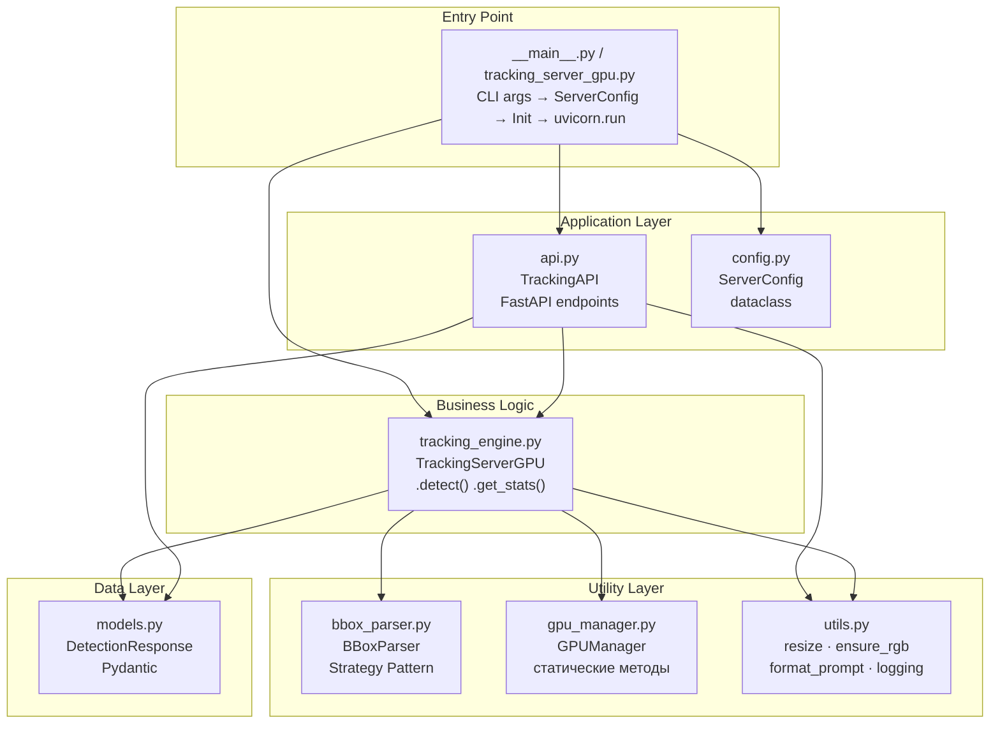
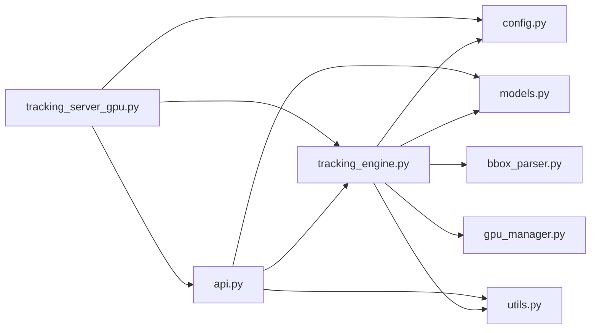
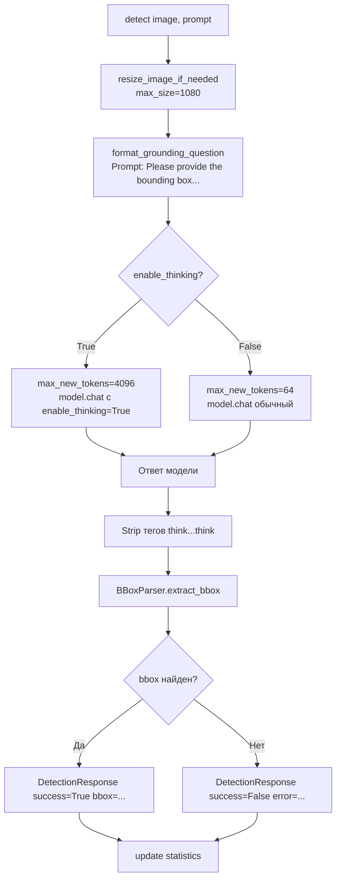
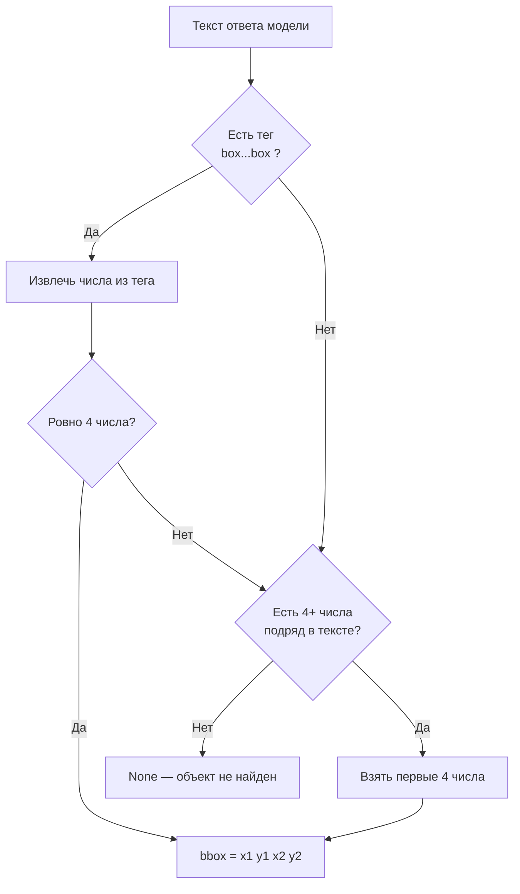
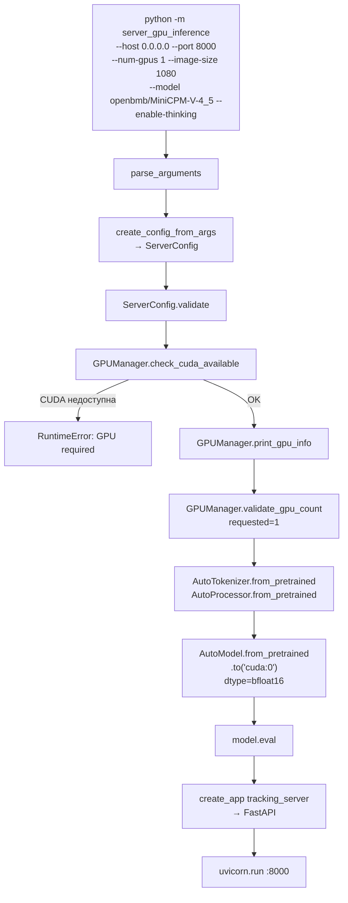
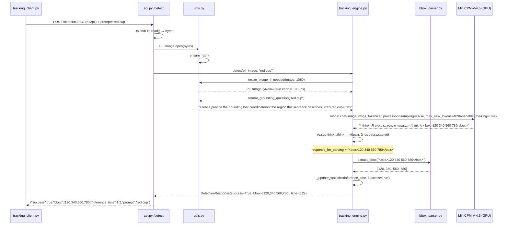
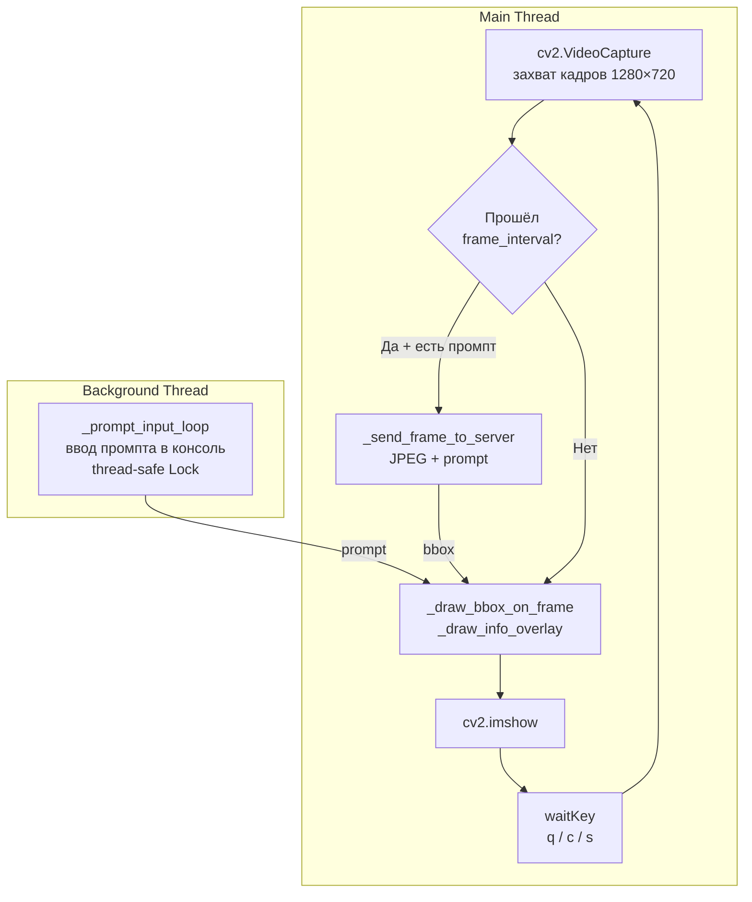
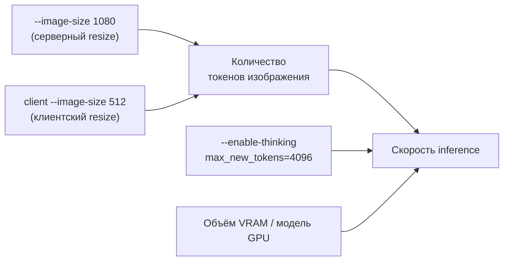

# MiniCPM-V-4.5 Tracking System — Документация сервера

---

## Содержание

1. [Команда запуска](#1-команда-запуска)
2. [Общая схема системы](#2-общая-схема-системы)
3. [Структура папки](#3-структура-папки)
4. [Архитектура сервера `server_gpu_inference`](#4-архитектура-сервера-server_gpu_inference)
5. [Описание модулей](#5-описание-модулей)
6. [Поток данных](#6-поток-данных)
7. [Режим thinking (`--enable-thinking`)](#7-режим-thinking---enable-thinking)
8. [API эндпоинты](#8-api-эндпоинты)
9. [Клиентский компонент](#9-клиентский-компонент)
10. [Производительность](#10-производительность)

---

## 1. Команда запуска

Сервер запускается исключительно следующей командой:

```bash
cd tracking_client_server
python -m server_gpu_inference \
    --host 0.0.0.0 \
    --port 8000 \
    --num-gpus 1 \
    --image-size 1080 \
    --model openbmb/MiniCPM-V-4_5 \
    --enable-thinking
```

### Параметры запуска

| Параметр | Значение | Описание |
|----------|---------|---------|
| `--host` | `0.0.0.0` | Принимать подключения со всех интерфейсов |
| `--port` | `8000` | Порт FastAPI сервера |
| `--num-gpus` | `1` | Использовать одну GPU |
| `--image-size` | `1080` | Максимальный размер стороны изображения (px) перед inference |
| `--model` | `openbmb/MiniCPM-V-4_5` | Модель с HuggingFace |
| `--enable-thinking` | флаг | Включить режим рассуждений модели |

### Управление процессом

```bash
# Мониторинг GPU в реальном времени
nvtop

# Снимок нагрузки GPU
nvidia-smi

# Найти PID сервера на порту 8000
lsof -i :8000

# Остановить сервер
kill -9 $(lsof -t -i :8000)
# или
fuser -k 8000/tcp
```

---

## 2. Общая схема системы

```mermaid
graph LR
    subgraph Windows["💻 Windows (клиент)"]
        CAM[Веб-камера]
        CLIENT[tracking_client.py]
        DISPLAY[OpenCV окно\nс bbox overlay]
    end

    subgraph Linux["🖥️ Linux (сервер)"]
        API[FastAPI\n:8000]
        ENGINE[TrackingServerGPU\ntracking_engine.py]
        MODEL["MiniCPM-V-4.5\nGPU · bfloat16\n--enable-thinking"]
    end

    CAM -->|кадр| CLIENT
    CLIENT -->|POST /detect\nJPEG + prompt| API
    API --> ENGINE
    ENGINE -->|model.chat| MODEL
    MODEL -->|текст с bbox| ENGINE
    ENGINE -->|DetectionResponse| API
    API -->|JSON bbox [x1,y1,x2,y2]| CLIENT
    CLIENT --> DISPLAY
```

---

## 3. Структура папки

```
tracking_client_server/
│
├── tracking_client.py              ← Клиент Windows (веб-камера)
│
└── server_gpu_inference/           ← Сервер (используется в продакшене)
    ├── __init__.py                 ← Публичный API пакета
    ├── __main__.py                 ← Точка входа: python -m server_gpu_inference
    ├── tracking_server_gpu.py      ← CLI → Config → Init → uvicorn.run
    ├── config.py                   ← ServerConfig dataclass + валидация
    ├── models.py                   ← Pydantic-модели ответов API
    ├── bbox_parser.py              ← Извлечение bbox из текста модели
    ├── gpu_manager.py              ← Утилиты CUDA / GPU
    ├── tracking_engine.py          ← Основной inference движок ⭐
    ├── api.py                      ← FastAPI роуты
    ├── utils.py                    ← Вспомогательные функции
    └── markdown/                   ← Документация модуля
```

> Остальные файлы в папке (`tracking_server.py`, `server_cpu_inference/` и др.) не используются.

---

## 4. Архитектура сервера `server_gpu_inference`

### Слои системы



### Зависимости между модулями



---

## 5. Описание модулей

### `tracking_server_gpu.py` — Entry Point

Точка входа. Принимает CLI аргументы, создаёт `ServerConfig`, инициализирует движок и запускает `uvicorn`.

```python
args = parse_arguments()
config = create_config_from_args(args)
tracking_server = TrackingServerGPU(config)
app = create_app(tracking_server)
uvicorn.run(app, host=config.host, port=config.port)
```

---

### `config.py` — Конфигурация

```python
@dataclass
class ServerConfig:
    model_name: str = "openbmb/MiniCPM-V-4_5"
    num_gpus: int = 1
    max_image_size: int = 768       # перекрывается флагом --image-size 1080
    host: str = "0.0.0.0"
    port: int = 8000
    enable_thinking: bool = False   # включается флагом --enable-thinking
    max_new_tokens: int = 64        # в обычном режиме
    max_new_tokens_thinking: int = 4096  # в режиме thinking
    use_sampling: bool = False
```

Метод `validate()` проверяет допустимые диапазоны всех параметров при создании.

---

### `tracking_engine.py` — Ядро inference ⭐

Главный класс системы. Отвечает за загрузку модели и выполнение детекции.

**Загрузка модели:**
- `--num-gpus 1` → `model.to('cuda:0')`, dtype `bfloat16`
- Загружаются `AutoModel`, `AutoTokenizer`, `AutoProcessor` (нужен для thinking mode)

**Метод `detect(image, prompt)`:**



---

### `bbox_parser.py` — Парсинг bounding box

Strategy Pattern: две стратегии последовательно.



Координаты нормализованы в диапазоне **0–1000** (не пиксели).

---

### `gpu_manager.py` — Управление GPU

Все методы статические (utility class):

| Метод | Описание |
|-------|---------|
| `check_cuda_available()` | Проверка доступности CUDA; при отсутствии сервер не стартует |
| `get_gpu_count()` | Число доступных GPU |
| `print_gpu_info()` | Лог информации о GPU в консоль |
| `validate_gpu_count(requested, available)` | Корректировка числа GPU если запрошено больше доступного |

---

### `api.py` — FastAPI эндпоинты

Использует Dependency Injection — `TrackingAPI` получает движок через `set_tracking_server()`, не через глобальную переменную.

```python
class TrackingAPI:
    def set_tracking_server(self, server: TrackingServerGPU): ...

def create_app(tracking_server: TrackingServerGPU) -> FastAPI:
    api = TrackingAPI()
    api.set_tracking_server(tracking_server)
    return api.app
```

---

### `models.py` — Модели данных

```python
class DetectionResponse(BaseModel):
    success: bool
    bbox: Optional[List[int]] = None   # [x1, y1, x2, y2] в 0-1000
    error: Optional[str] = None
    inference_time: float
    prompt: str
```

---

### `utils.py` — Вспомогательные функции

| Функция | Описание |
|---------|---------|
| `resize_image_if_needed(image, max_size)` | Уменьшает PIL Image до `max_size` по длинной стороне |
| `ensure_rgb(image)` | Конвертирует в RGB если нужно (RGBA, L, и т.д.) |
| `format_grounding_question(prompt)` | Формирует текст запроса для grounding |
| `print_section_header(title)` | Форматированный лог |
| `print_detection_log(...)` | Лог результата детекции |

---

## 6. Поток данных

### Инициализация сервера



### Обработка одного запроса



---

## 7. Режим thinking (`--enable-thinking`)

Флаг `--enable-thinking` включает в модели режим внутреннего рассуждения (Chain-of-Thought).

### Что меняется при включённом thinking

| Параметр | Без thinking | С thinking (`--enable-thinking`) |
|----------|:-----------:|:---------------------------------:|
| `enable_thinking` в `model.chat` | `False` | `True` |
| `max_new_tokens` | `64` | `4096` |
| Ответ модели | `<box>x y x y</box>` | `<think>..рассуждения..</think><box>x y x y</box>` |

### Обработка ответа с thinking

После получения ответа от модели блок `<think>...</think>` вырезается **до** передачи в `BBoxParser`:

```python
response_for_parsing = re.sub(
    r"<think>.*?</think>",
    "",
    response,
    flags=re.DOTALL
).strip()
bbox = self.bbox_parser.extract_bbox(response_for_parsing)
```

Это критично: без удаления тега `<think>` цифры из рассуждений могут ошибочно попасть в bbox через fallback-парсер.

---

## 8. API эндпоинты

| Метод | Путь | Описание |
|-------|------|---------|
| `GET` | `/` | Информация о сервере (модель, num_gpus, dtype) |
| `GET` | `/health` | Health check: `model_loaded`, `num_gpus`, `device`, `dtype` |
| `GET` | `/stats` | Статистика: запросы, success rate, среднее время |
| `POST` | `/detect` | Детекция объекта на изображении |

### POST /detect

**Запрос** (multipart/form-data):
```
image: <бинарный JPEG/PNG файл>
prompt: "red cup"
```

**Ответ** (JSON):
```json
{
  "success": true,
  "bbox": [120, 340, 560, 780],
  "error": null,
  "inference_time": 1.24,
  "prompt": "red cup"
}
```

**Формат bbox:** `[x1, y1, x2, y2]` — нормализованные координаты **0–1000**.

Перевод в пиксели на клиенте:
```python
x1_px = int(bbox[0] / 1000 * frame_width)
y1_px = int(bbox[1] / 1000 * frame_height)
x2_px = int(bbox[2] / 1000 * frame_width)
y2_px = int(bbox[3] / 1000 * frame_height)
```

### GET /health

```json
{
  "status": "healthy",
  "model_loaded": true,
  "num_gpus": 1,
  "device": "CUDA",
  "dtype": "bfloat16"
}
```

### GET /stats

```json
{
  "total_requests": 150,
  "successful_detections": 134,
  "success_rate": "89.3%",
  "avg_inference_time": "1.24s",
  "device": "CUDA (GPU x1)",
  "dtype": "bfloat16",
  "multi_gpu_mode": "single"
}
```

---

## 9. Клиентский компонент

**`tracking_client.py`** — запускается на Windows-машине с веб-камерой.

### Архитектура клиента



### Параметры клиента

| Параметр | Default | Описание |
|----------|---------|---------|
| `--server` | `http://localhost:8000` | URL сервера |
| `--camera` | `0` | ID веб-камеры |
| `--fps` | `1.5` | Частота отправки кадров на сервер |
| `--quality` | `85` | JPEG качество (0–100) |
| `--image-size` | `512` | Resize кадра перед отправкой (px) |

### Оптимизации передачи

- **Resize до 512px** на клиенте — меньше токенов → быстрее inference на сервере
- **JPEG quality=85** — сжатие ~24x по сравнению с raw
- **Размеры кратные 16** — оптимально для vision encoder
- **Frame throttle** — запросы не чаще `target_fps` раз в секунду

### Горячие клавиши

| Клавиша | Действие |
|---------|---------|
| `q` | Выход |
| `c` | Очистить текущий промпт |
| `s` | Показать GET /stats сервера в консоли |

### Информация в overlay

На видео в реальном времени отображается:
- Текущий промпт
- Display FPS (скользящее среднее, 30 кадров)
- Inference Time (среднее из 10 последних запросов)
- Network Time (среднее из 10 последних запросов)
- Статус сервера: **ONLINE** / **OFFLINE**

---

## 10. Производительность

| Параметр | Значение |
|---------|---------|
| Модель | MiniCPM-V-4.5 |
| Dtype | bfloat16 |
| Устройство | CUDA GPU |
| Inference (без thinking) | ~0.5–1.5 с |
| Inference (с thinking) | ~1–5 с (зависит от сложности) |
| Рекомендуемый FPS клиента | 1–2 |

### Что влияет на скорость



> **Совет:** клиентский `--image-size 512` уменьшает токены изображения ещё до отправки на сервер. Серверный `--image-size 1080` — финальное ограничение на стороне inference.

---

*Документация актуальна для `tracking_client_server/server_gpu_inference/` — апрель 2026*
